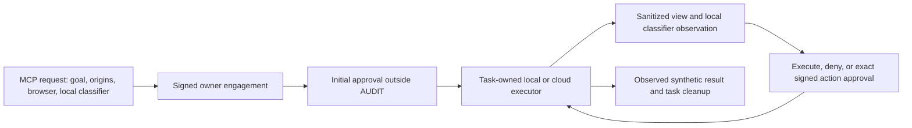

# Automated browser flow

Run `npm run demo:flow` from this branch. It builds the application, checks source imports and MCP discovery, runs the unit suite, then drives a local Worker, stdio MCP client, paired extension and synthetic product-search site. The command writes `artifacts/flow/report.json` and removes its temporary profiles, browsers, servers and Worker state.

Prerequisites are Node 22+, `npm ci`, and Playwright Chromium (`npx playwright install chromium`). The optional real ONNX pass uses an existing verified bundle in `extension/models/purpose`; run `npm run build:purpose` with the project's evaluated checkpoint to install one. Missing real model assets are reported separately from fixture conformance. Model training or downloads do not occur during the demo.

Native probes use fresh temporary profiles. They copy no browser profiles or native model caches. Native availability must be `available` before inference starts. Playwright's OptimizationHints suppression is removed for the native test; no native feature override or model setup gesture is requested. Pending availability is recorded as unresolved readiness.

For the visible demo, run `AGENTGATE_FLOW_CAPTURE=1 npm run demo:flow`, then `node scripts/package-flow-demo.mjs` and `npm run build`. The generated `public/e2e-demo.html` contains screenshots of the actual owner UI, browser actions, real ONNX observations and completion. Both real ONNX routes use signed AUDIT consent. The cloud acquisition is emulated. A separate fixture example exercises conditional task and exact-action approval through the real owner UI, using an ephemeral test key in an isolated browser context. No production owner approval is automated.

The ONNX relevance model withheld the search controls in the attempted non-AUDIT real-model task. Its action-effect accuracy remains unverified. The recorded real-model flow therefore uses the supported AUDIT setting and keeps the deterministic scope, credential and final-commit restrictions. The extension download is a code update; keep existing local model files and WASM when updating an already installed extension.

The owner chooses engagement. Signed AUDIT consent starts a scoped task without another session approval and records semantic concerns without blocking routine steps. Balanced and Careful require initial task approval. Relevant uncertain actions require exact signed approval; semantic denial is enforced. Careful also confirms scores below 0.98. No model confidence grants origin, credential or final-commit authority. Real purchases, sending, credentials and final submissions remain blocked in this flow.

Both executors use the paired local classifier. Cloud requests and results are bound to the signed scope, current view, actual action and live device identity. Replayed, modified, expired or revoked results cannot authorize execution. There is no remote classifier fallback.

Five tools are defined in `mcp/contract.mjs`: list runtimes, request a session, get its view/status, act, and close. The coordinator parses this same contract. `npm run api:generate` regenerates `docs/mcp-schema.json` through actual SDK discovery; `npm run test:contract` rejects drift. Old disclosure, interaction, validation, checkout and DOM-selector fields/tools are absent. An existing connected client's cached tools must refresh before using the new contract.

Test approvals are normal ephemeral P-256 owner signatures through the production approval routes. The signing key exists only inside the harness. The cloud emulator lives in `tests/flow/worker.mjs`, behind a loopback address and random per-run bearer credential, and drives the production hosted adapter against isolated local Chromium. Production configuration and its dependency graph exclude this entrypoint. No production approval-bypass flag exists.

| Component | Verification |
|---|---|
| Worker, Durable Object storage, HTTP authorization | Real local workerd with temporary storage |
| MCP discovery and calls | Real stdio SDK; root/tenant HTTP discovery also tested |
| Owner approvals | Real ECDSA signatures and production verification; owner signer automated only in harness |
| Local browser | Real temporary Chromium extension, content reader, action dispatch and WebSocket connection |
| Cloud browser | Real HostedBrowser/HostedAdapter and isolated Chromium; acquisition/transport emulated locally |
| Twelve route/backend/mode combinations | Explicit deterministic classifier fixtures; AUDIT receives denial, other modes receive uncertainty |
| ONNX | Real identity-checked model/WASM; action inference and browser flow on both routes when bundle exists |
| Chrome built-in AI in extension | API and offscreen transport are present. Tested Chrome for Testing 153/154 cache profiles remain `downloading`; a real guard request returns `MODEL_UNAVAILABLE`. AUDIT/unavailable behavior passes, and non-AUDIT blocks before publication or action dispatch. |
| Chrome web Prompt API | Separate real production ModelRuntime component probe; does not prove extension integration |
| Live Cloudflare acquisition | Unverified by this command |

The failure suite covers initial rejection, stale owner approvals, cancellation during action approval, stale views, changed replay keys, origin escape, final-commit denial in AUDIT, revocation, classifier disconnect on both routes, and task-tab cleanup. Unit tests also verify tampered signatures, classifier-result binding/replay, expired commands, uncertain dispatch and recognized credential/sensitive-data filtering.

This branch removes purchase policies, cart parsing/checkout encryption and submission, legacy element-disclosure execution, remote classifier selection from the live model host, obsolete tests/scripts, and `legacy/v0.1`. Existing pairing, OAuth/account isolation, encrypted login infrastructure, quota diagnostics, browser acquisition/cleanup and recording remain. Freshness, signed authorization, scope binding and replay safeguards are retained as required protections. Persisted production data, secrets, deployment configuration and the original dirty worktree are untouched.

The repository has no configured ESLint or TypeScript project. `check:source` validates JavaScript syntax, bundles frontend imports, and verifies that the production Worker excludes demo code. Strict Zod contracts and runtime conformance tests validate API data. No static TypeScript result is claimed.

Native extension setup is checked in the actual production offscreen document before the real-model pass. `npm run test:native-extension` compares fresh Chrome for Testing and installed Chrome profiles, using bounded availability queries and a synthetic guardian request. `AGENTGATE_NATIVE_EXECUTABLE` can select an already installed extension-test-compatible Chrome binary. No setup gesture or model creation is requested by these commands.

Native setup remains unresolved. Earlier copied-cache tests reported `downloading` across seven samples; those samples do not prove an active model download or a terminal failure. A fresh retained profile with normal component networking was observed for 120 samples over 597 seconds. Its availability promise remained pending and the actual offscreen availability request returned `MODEL_TIMEOUT`. Both model directories remained empty; the separate component cache stayed at 1,510,938 bytes. Ordinary Chrome components downloaded successfully. A second profile launched with normal Chrome defaults reached the AgentGate extension and also had a pending availability promise. Native extension inference remains unverified.

The read-only diagnostics are `node scripts/native-download-status.mjs` and `node scripts/native-normal-status.mjs`. They use marked owned profiles, copy no profiles or models, and retain the browser/profile when readiness remains pending. Evidence is written under ignored `artifacts/native-download/`. The test machine has 24 GiB RAM, 15 CPU cores and 515 GB free on the profile volume. The model manifest remains version `0.0.0.0`; Chrome's detailed model internals are disabled and the debug-page setting was left unchanged. Initial download setup requires a user gesture followed by `LanguageModel.create()`, provided by the extension's Prepare Chrome AI button. No setup gesture or model creation was requested. Availability eligibility still needs to resolve before native inference can be verified.

[Chrome Prompt API documentation](https://developer.chrome.com/docs/ai/prompt-api) defines availability and download setup. [Playwright's extension documentation](https://playwright.dev/docs/chrome-extensions) documents the installed-Chrome side-loading restriction. Native readiness evidence is in `docs/native-extension-verification.json`.
